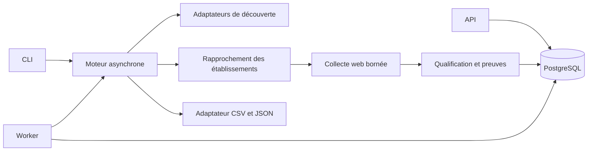

# Architecture Core V2

Le moteur réutilise le contrat `BaseSource`, les extracteurs et les filtres de la CLI. Chaque recherche garde l'ordre demandé des sources même si elles terminent à des moments différents. Les erreurs attendues ont un état explicite. Un résultat sans site connu est exploitable si l'établissement a une identité certaine.

`Company` reste le modèle échangé avec la CLI. Il représente une fiche établissement avec SIRET, entreprise juridique (SIREN), éventuelle enseigne, site candidat, contacts et observations. Les sources de référence peuvent déclarer une valeur vérifiée au registre. Le succès HTTP confirme l'accès à une page. Le rapprochement du site exige le SIRET exact et un nom compatible dans le titre ou un titre principal de la page d'accueil. L'historique et les conflits sont portés par des observations datées.

PostgreSQL porte les recherches, les exécutions, les résultats de recherche et les identités légales. Les observations, états d'enrichissement, sites, contacts et scores sont versionnés par résultat dans une projection JSONB. Les checkpoints par source et par fiche permettent la reprise sous le même identifiant. Un verrou consultatif PostgreSQL empêche deux exécutions simultanées d'une recherche. Un arrêt du processus libère ce verrou. Une contrainte d'unicité s'applique aux couples recherche et SIRET. Une transaction enregistre chaque checkpoint. Le worker traite les recherches hors du processus HTTP. La CLI peut exécuter le moteur avec ou sans PostgreSQL.

La frontière réseau vérifie les schémas, les utilisateurs et ports, les IP et chaque redirection. Un resolver filtre les réponses DNS utilisées pour la connexion. Les fetchs web ont des limites de taille, de temps et de concurrence. La découverte par navigateur historique relève de l'exploitation autorisée. L'API et le worker utilisent la source publique.

Le profil agences web évalue des signaux observables avec une explication et leurs pages d'origine. La complétude historique, la qualité, la pertinence commerciale et la confiance restent des valeurs distinctes.

## États et limites de la qualification

`unknown` signale l'absence de candidat exploitable dans la recherche. `candidate_reachable` signale un HTTP réussi avec rattachement encore incertain. `candidate_unreachable` couvre les échecs observés dans le budget. `official_confirmed` signifie que la règle de corroboration a été satisfaite sur le HTML observé. Les observations conservent la méthode et la page. La réservation est un signal de lien détecté. L'ergonomie mobile reste à mesurer par rendu.

Le catalogue autorisé est actuellement l'entrée la plus directe pour fournir des candidats web au moteur. Les recherches déposées via l'API utilisent la source publique. Le système de file peut traiter plusieurs recherches avec plusieurs workers. Le débit sortant global et les droits par espace de travail devront être ajoutés avant un déploiement public.
